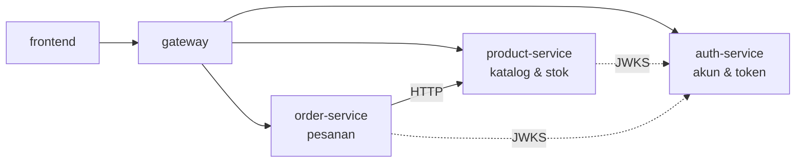

1. Pengelompokan

| Domain event     | Dipicu oleh               | Data inti              |
| ---------------- | ------------------------- | ---------------------- |
| `UserRegistered` | calon pelanggan mendaftar | email, password (hash) |
| `UserLoggedIn`   | pelanggan login           | kredensial → token     |
| `ProductCreated` | admin menambah produk     | nama, harga, stok      |

2. Bounded context

3. Alasan Pemisahan

4. Cara desain ini menghindari tiga anti-pattern

5. Pengantar Saga