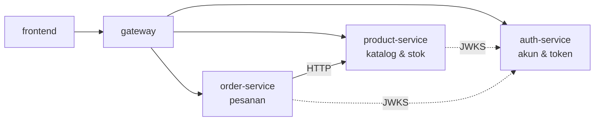

# m1.1 — Desain Batas Layanan (Service Boundary)

| Branch awal                     | Kunci jawaban                    | Waktu    | Sebelumnya | Berikutnya |
| ------------------------------- | -------------------------------- | -------- | ---------- | ---------- |
| `starter/m1.1-service-boundary` | `solution/m1.1-service-boundary` | 60 menit | m0.2       | m1.2       |

## Yang akan Anda pelajari

- Menemukan batas layanan dari **kejadian bisnis** (event storming ringan).
- Membedakan microservice yang sehat dari tiga anti-pattern yang paling sering terjadi.
- Kapan komunikasi sinkron (HTTP) cukup, dan kapan butuh Saga atau message queue.

Lab ini **tidak menulis kode**. Hasilnya satu dokumen desain, `docs/BOUNDARY.md`,
yang menjadi pegangan untuk semua lab berikutnya.

## Kondisi awal

Hasil m0.2: logger bersama dan kerangka frontend. Belum ada service.

```bash
git switch starter/m1.1-service-boundary
npm ci
```

## Konsep singkat

Pertanyaan utamanya: **data apa yang dimiliki oleh siapa?** Sebuah layanan yang baik
memiliki datanya sendiri dan menjadi satu-satunya yang mengubah data itu. Layanan
lain hanya boleh bertanya lewat API-nya.

Tiga anti-pattern yang harus Anda hindari:

| Anti-pattern         | Ciri-ciri                                                             |
| -------------------- | --------------------------------------------------------------------- |
| Distributed monolith | Layanan terpisah, tetapi harus di-deploy bersama dan saling menunggu. |
| Nanoservice          | Layanan terlalu kecil; biaya jaringannya lebih besar dari manfaatnya. |
| Shared database      | Beberapa layanan membaca/menulis tabel yang sama secara langsung.     |

## Langkah-langkah

Buat berkas `docs/BOUNDARY.md` dengan lima bagian berikut.

### Langkah 1 — Event storming ringan

Tulis tabel kejadian bisnis (domain event) dalam bentuk lampau. Untuk setiap
kejadian catat siapa yang memicunya dan data intinya. Contoh tiga baris pertama:

| Domain event     | Dipicu oleh               | Data inti              |
| ---------------- | ------------------------- | ---------------------- |
| `UserRegistered` | calon pelanggan mendaftar | email, password (hash) |
| `UserLoggedIn`   | pelanggan login           | kredensial → token     |
| `ProductCreated` | admin menambah produk     | nama, harga, stok      |

Lanjutkan sendiri: kejadian apa yang terjadi saat produk diubah, dilihat, dipesan,
dan saat stok tidak cukup?

### Langkah 2 — Bounded context ke service

Kelompokkan kejadian yang memakai data yang sama. Setiap kelompok menjadi satu
service. Gambarkan dengan diagram Mermaid (GitHub dan VS Code bisa menampilkannya):

````markdown

````

### Langkah 3 — Alasan pemisahan

Untuk setiap service, tulis dua atau tiga kalimat: data apa yang dimilikinya,
mengapa data itu berubah karena alasan yang berbeda dari data service lain, dan
siapa yang boleh mengubahnya.

### Langkah 4 — Cara desain ini menghindari tiga anti-pattern

Untuk **masing-masing** anti-pattern, jelaskan **mekanisme** yang mencegahnya. Jangan
hanya menyebut istilahnya. Contoh untuk shared database: "product-service satu-satunya
yang menulis stok; order-service mengurangi stok dengan memanggil API
product-service, tidak pernah menulis ke datanya langsung."

### Langkah 5 — Pengantar Saga

Pembuatan pesanan menyentuh dua service (order dan product). Jelaskan:

- apa yang terjadi bila stok berhasil dikurangi tetapi pesanan gagal disimpan;
- apa itu **kompensasi** (langkah pembatalan);
- kapan komunikasi HTTP sinkron masih cukup, dan kapan message queue lebih tepat.

Anda akan benar-benar membangun saga pembatalan pesanan di lab m12.2.

## Kriteria lulus

- [ ] `docs/BOUNDARY.md` berisi kelima bagian di atas.
- [ ] Ada diagram Mermaid yang tampil benar (pratinjau Markdown di VS Code: `Ctrl+Shift+V`).
- [ ] Setiap anti-pattern dijelaskan dengan mekanisme pencegahannya, bukan hanya nama.
- [ ] `npx prettier --check docs/BOUNDARY.md` lulus.

## Bila ada masalah

| Gejala                       | Solusi                                                                                                                              |
| ---------------------------- | ----------------------------------------------------------------------------------------------------------------------------------- |
| Diagram Mermaid tidak tampil | Blok kode harus diawali ` ```mermaid `. Pasang ekstensi VS Code "Markdown Preview Mermaid Support".                                 |
| Bingung memisahkan service   | Tanyakan: "bila aturan bisnis X berubah, service mana yang harus diubah?" Jawaban yang selalu "dua service" berarti batasnya salah. |

## Bandingkan dengan solution

```bash
git show solution/m1.1-service-boundary:docs/BOUNDARY.md
```

Tidak ada jawaban tunggal yang benar. Yang dinilai adalah alasan Anda.

## Lanjut

```bash
git switch starter/m1.2-auth-bootstrap
npm ci
```
