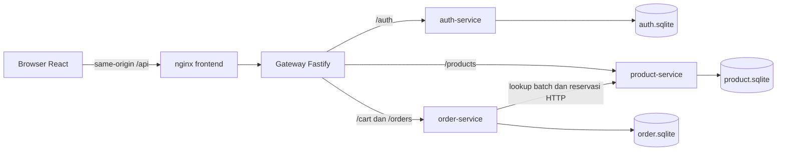
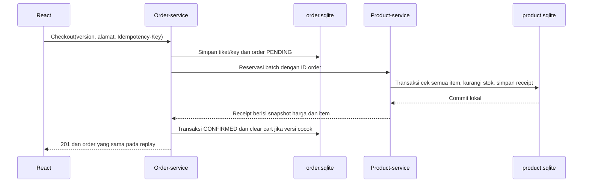
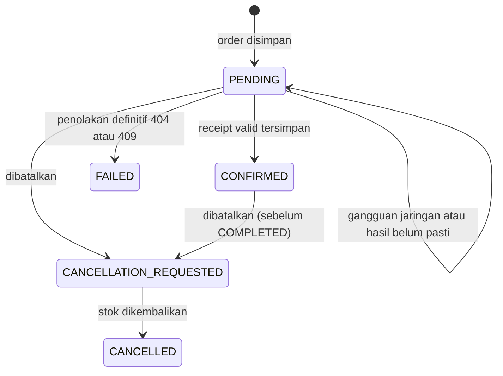

# Modul peserta — alur belanja, konsistensi, dan operasional admin

## Orientasi kasus

Prototype awal sudah memiliki autentikasi, katalog, pemesanan satu langkah, gateway, dan health widget. Pengembangan berikutnya mengubahnya menjadi alur belanja yang dapat dipakai pelanggan dan dioperasikan admin. Perubahan antarmuka didukung aturan bisnis pada backend; menyembunyikan tombol saja tidak cukup.

Gunakan analogi mal pada modul dasar: pelanggan menyimpan daftar belanja, kasir mengonfirmasi barang, gudang mengalokasikan stok, dan petugas memproses pesanan. Daftar belanja bukan bukti stok sudah dialokasikan. Nomor transaksi yang sama tidak boleh membuat gudang mengambil barang dua kali.

### Arsitektur setelah penambahan



Terdapat lima container seperti sebelumnya; paket ini tidak menambah service keranjang atau pembayaran. Auth tetap memiliki pengguna dan signing key. Product memiliki katalog, stok tersedia, dan receipt reservasi. Order memiliki keranjang, tiket checkout, idempotensi, dan pesanan. Setiap service memiliki database sendiri; tidak ada query lintas file database service.

Diagram menggambarkan alur bisnis. Validasi JWT/JWKS dan correlation ID tetap berlaku. Komunikasi order → product masih sinkron melalui HTTP yang dilindungi timeout, retry, dan circuit breaker; belum memakai message broker.

## M5 — Penguatan sistem setelah audit

**Tujuan:** menjelaskan perubahan fondasi yang diperlukan sebelum memperluas fitur bisnis.

### 1. Dari Map ke database persisten

Data sebelumnya berada di `Map` dan hilang ketika proses berhenti. Sekarang `packages/storage` memakai SQLite dengan tabel `records(namespace, key, value)`. Pasangan `(namespace, key)` merupakan primary key; `value` menyimpan JSON. Nama seperti `orders` atau `carts` adalah namespace record, bukan tabel SQL terpisah.

Transaksi lokal menggunakan `BEGIN IMMEDIATE`, diikuti `COMMIT` atau `ROLLBACK`. Mode WAL dan synchronous FULL mendukung konsistensi penyimpanan. Docker memasang volume data terpisah untuk auth, product, dan order. Signing key tetap memakai volume tersendiri.

Primary key membantu registrasi email: walaupun dua request melewati pengecekan awal sebelum hashing selesai, hanya satu insert email ternormalisasi yang dapat berhasil. Pemeriksaan `has(email)` sebelum `await` saja belum memberikan jaminan unik.

SQLite menyelesaikan persistensi dan transaksi pada deployment ini, tetapi tidak otomatis menyelesaikan distribusi data antarhost. Backup dilakukan melalui online backup API, bukan menyalin file utama yang sedang ditulis tanpa memperhitungkan WAL. Pembahasan restore dan secrets berada di [HARDENING.md](../HARDENING.md).

### 2. Validasi dan autentikasi

Harga memakai integer rupiah; kuantitas dan total divalidasi. Password pengguna minimal delapan karakter dan maksimal 72 byte UTF-8 untuk menyesuaikan bcrypt. Delapan karakter tidak selalu sama dengan delapan byte. Email di-trim dan dinormalisasi ke huruf kecil; register publik hanya menghasilkan role pengguna.

JWT diterbitkan dengan RS256 dan diverifikasi berdasarkan algoritme, issuer, audience, subject, serta expiry. Product dan order mengambil public key melalui JWKS. Access token berumur 15 menit dan hanya disimpan di memory React. Sesi dipertahankan oleh refresh token di cookie `HttpOnly; SameSite=Strict`, yang dirotasi setiap dipakai dan dicabut saat logout; karena itu sesi tetap ada setelah halaman dimuat ulang. Frontend memperbarui access token sebelum kedaluwarsa dan keluar bila pembaruan gagal. Respons terlambat dari sesi lama tidak boleh menghapus sesi baru. Detail dan pemetaan ke OWASP ada di [M11](07-keamanan-api-owasp.md).

### 3. Ketahanan HTTP yang benar-benar mencakup body

`fetch()` dapat selesai menerima header sementara body masih dikirim. Karena itu timeout sekarang mencakup pembacaan body dan membatasi ukuran respons internal. Retry hanya berlaku pada kegagalan yang diklasifikasikan layak dicoba ulang, dengan operasi aman atau idempotency key. Pembatalan caller menghentikan request/backoff, bukan memulai retry tambahan.

Circuit breaker memakai generasi state. Keberhasilan request lama tidak boleh menutup breaker yang telah dibuka request lain. Saat HALF_OPEN hanya satu probe diizinkan. Deadline keseluruhan membatasi durasi seluruh rangkaian, bukan sekadar setiap attempt.

### 4. Health, error, dan konfigurasi

Probe health dipisahkan dari kuota bisnis. Gateway meng-cache hasil agregat sekitar satu detik dan menyatukan probe yang sedang berjalan. Ini mencegah banyak widget memicu probe downstream yang sama secara berlebihan.

JSON rusak dipetakan ke 400, payload terlalu besar ke 413, dan rate limit ke 429. Error handler gateway dipasang sebelum registrasi proxy agar scope plugin mewarisi handler yang benar. Custom error rate-limit tetap membawa `statusCode`; membuangnya dapat mengubah 429 menjadi 500.

Admin bootstrap bersifat opt-in dengan password acak. File secrets, TLS opsional, binding loopback, pembatasan trust proxy, container non-root, batas resource, dan graceful shutdown memperkuat pengoperasian lokal. Praktik tersebut tidak berarti seluruh persyaratan production sudah selesai.

**Pertanyaan pengamatan:** mengapa transaksi SQLite di product-service tidak dapat sekaligus meng-commit record order pada order-service?

## M6 — Keranjang persisten dan versi optimistis

**Tujuan:** membedakan state tampilan, state yang disimpan, dan data turunan.

### Data yang disimpan dan dihitung

Keranjang disimpan berdasarkan user ID dari JWT, bukan user ID bebas di body. Record berisi `version`, pasangan `productId/quantity`, dan `updatedAt`. Nama, harga, stok, subtotal, total, jumlah barang, dan `canCheckout` dihitung saat `GET /cart` dengan lookup batch ke product-service.

Frontend memakai `CartProvider` untuk memuat keranjang setelah login dan menyediakan operasi tambah, ubah, hapus, dan reload. Pembacaan yang berjalan disatukan; respons lama tidak boleh menimpa pembacaan lebih baru. Badge header menunjukkan **jumlah unit**, bukan jumlah jenis produk; angka di atas 99 ditampilkan sebagai `99+` dengan label aksesibel yang tetap menyebut jumlah sebenarnya.

### Mengapa perlu version?

Bayangkan dua tab membaca versi V1. Tab A mengubah jumlah menjadi tiga dan server menghasilkan V2. Tab B kemudian mengirim perubahan berdasarkan V1. Jika server langsung menerima perubahan itu, keputusan berdasarkan tampilan lama dapat menimpa perubahan tab A.

Versi dikirim sebagai header HTTP standar: respons keranjang membawa `ETag: "<version>"`, dan setiap mutasi wajib mengirim `If-Match` dengan nilai itu. Versi lama ditolak 412 `CART_CHANGED`; mutasi tanpa `If-Match` ditolak 428. Frontend harus memuat ulang state, lalu pengguna memutuskan perubahan berikutnya. (`version` di body masih diterima sementara dengan header `Deprecation: true` dan konflik 409.) Header dipakai karena body pada `DELETE` tidak punya arti baku di HTTP dan dapat dibuang proxy. `PUT` mengatur jumlah absolut; ia bukan instruksi menambah sejumlah unit.

```text
Tab A: baca ETag "V1" ── PUT quantity=3, If-Match "V1" ── berhasil → ETag "V2"
Tab B: baca ETag "V1" ── PUT quantity=4, If-Match "V1" ── ditolak 412
```

Keranjang dibatasi 50 produk berbeda, masing-masing 1–1000 unit. Menambahkan barang ke keranjang tidak mengurangi stok. Produk yang hilang tetap tampil sebagai tidak tersedia dan dapat dihapus; `canCheckout` menjadi false. Bila product-service tidak dapat dibaca, keranjang berisi barang tidak dapat di-quote dengan andal dan GET dapat gagal. Keranjang kosong tidak membutuhkan lookup produk.

**Latihan konsep:** jelaskan mengapa menyimpan harga pada state React lalu mengirim total ke server bukan sumber harga yang dapat dipercaya.

## M7 — Checkout, idempotensi, dan reservasi stok

**Tujuan:** menjelaskan satu keputusan belanja sebagai operasi yang aman terhadap konkurensi dan kegagalan jaringan.

### Tiga identitas yang berbeda

| Identitas          | Fungsi                                                                            |
| ------------------ | --------------------------------------------------------------------------------- |
| Versi keranjang    | Menentukan snapshot isi yang dipilih pelanggan                                    |
| `Idempotency-Key`  | Mengidentifikasi percobaan operasi dari klien; terikat pada pengguna dan checkout |
| ID order/reservasi | Menghubungkan order dengan receipt alokasi stok pada product-service              |

Satu versi keranjang menghasilkan paling banyak satu order. Jaminan ini juga berlaku ketika dua tab memilih idempotency key berbeda. Semua key yang diterima untuk checkout itu diikat ke versi asal agar tidak digunakan untuk keranjang atau order lain. Perubahan alamat pada checkout yang sama merupakan konflik, bukan pembaruan diam-diam terhadap transaksi lama.

### Alur sukses



Tiket checkout dan pembuatan order merupakan transaksi lokal terpisah dalam order-service; diagram merangkum langkahnya. Tidak ada transaksi database yang tetap terbuka sambil menunggu HTTP ke product-service.

Product menggabungkan kuantitas berdasarkan produk, memeriksa seluruh batch, lalu mengurangi stok dan menyimpan receipt dalam satu transaksi. Jika satu item kurang, batch dibatalkan. Pemeriksaan per baris tanpa penggabungan dapat menerima dua baris masing-masing 40 walaupun stok hanya 50; itulah salah satu bug yang diperbaiki.

Alamat disimpan sebagai snapshot pada order. Nama, unit price, kuantitas, subtotal, dan total dibekukan dari receipt tervalidasi. Perubahan harga katalog berikutnya tidak mengubah order lama. Harga saat melihat keranjang masih berupa quote; harga saat reservasi menjadi acuan akhir.

### Respons hilang dan recovery

Jika product sudah commit tetapi respons hilang, order-service belum tentu tahu hasilnya. Menyimpulkan bahwa transaksi pasti gagal akan berbahaya. Request berikutnya memakai ID reservasi yang sama; product mengembalikan receipt yang sama tanpa mengurangi stok lagi.



### Pembatalan sebagai saga dengan kompensasi

Membatalkan order melibatkan dua database: status order di order-service dan stok di product-service. Tidak ada transaksi yang mencakup keduanya, jadi pembatalan disusun sebagai **saga**. Langkah maju (reservasi) punya **kompensasi** (pelepasan stok).

1. order-service menyimpan niat batal secara durable: status `CANCELLATION_REQUESTED`.
2. order-service memanggil `release` di product-service. Pelepasan bersifat idempotent: memanggilnya dua kali tetap mengembalikan stok sekali.
3. Setelah berhasil, status menjadi `CANCELLED`. Bila product-service tidak terjangkau, API menjawab 202 dan recovery worker menyelesaikannya kemudian.

Kasus tersulit adalah order PENDING yang reservasinya masih "di jalan": request reservasi sudah dikirim tetapi hasilnya belum diketahui. Bila pelepasan untuk ID yang belum punya receipt hanya menjawab "tidak ada", reservasi yang tiba belakangan tetap mengambil stok dan stok bocor. Karena itu product-service menulis _tombstone_ untuk ID tersebut, dan reservasi berikutnya dengan ID itu ditolak.

Recovery worker berjalan saat startup dan berkala setiap sepuluh detik. Dalam satu pemanggilan, ia memproses maksimal 100 order PENDING atau CANCELLATION_REQUESTED, dimulai dari yang tertua, dan berhenti lebih awal bila product-service tidak terjangkau (503); pemanggilan worker tidak dibiarkan tumpang-tindih. Status akhir hanya ditulis bila order belum diselesaikan proses lain. Ini bukan janji bahwa setiap order selesai dalam sepuluh detik: durasi dipengaruhi antrean, retry, timeout, breaker, dan ketersediaan service. Operasi reservasi aktif per proses juga dibatasi.

Pada penolakan definitif, isi keranjang dipertahankan dan versi asal diperbarui agar percobaan baru setelah restock tidak terikat ke hasil gagal lama. Replay versi checkout lama tetap mengembalikan hasil lama. Jika pengguna mengubah keranjang ketika checkout berjalan, **seluruh versi baru dipertahankan**, termasuk item yang juga ada pada snapshot lama. Pelanggan harus memeriksa kembali barang yang tersisa; mengedit keranjang tidak membatalkan order pending.

Jika proses berhenti setelah tiket tersimpan tetapi sebelum order dibuat, belum ada alokasi stok pada langkah itu. Tiket dapat dilanjutkan melalui request checkout ulang. Worker saat ini memulihkan record order PENDING, bukan memindai tiket tanpa order.

**Diskusi:** jaminan yang diberikan adalah alokasi stok tidak berulang untuk reservasi yang sama. Jangan menyebutnya jaminan pengiriman HTTP “exactly once” di seluruh jaringan.

## M8 — Riwayat pesanan dan dashboard admin

**Tujuan:** memisahkan pengalaman pengguna, hak akses, dan proses operasional.

### Riwayat dan ownership

Pelanggan dapat melihat daftar miliknya, filter status, pagination, dan detail. Pencarian backend mencocokkan ID atau nama penerima. Detail menyertakan snapshot item/alamat dan polling untuk order PENDING. Pesanan lama tanpa alamat tetap ditampilkan dengan keterangan, bukan dianggap data rusak.

Ownership ditentukan oleh subject JWT. Pelanggan lain yang mencoba ID order tersebut menerima 404. Admin memiliki endpoint tersendiri untuk melihat seluruh order. Menyembunyikan menu admin pada React hanya membantu pengalaman pengguna; middleware backend tetap wajib memeriksa role.

### Ringkasan yang tidak menyesatkan

Ringkasan produk membedakan stok menipis, yaitu 1–5 unit, dan stok habis, yaitu nol. Ringkasan order berisi jumlah seluruh order, pending, confirmed, failed, nilai confirmed, serta yang sedang diproses. `confirmedValue` adalah nilai produk pada order terkonfirmasi, **bukan omzet pembayaran yang telah diterima**.

### Revisi produk dan lost update

Admin membaca produk pada revisi R1, lalu pelanggan checkout sehingga stok berkurang dan revisi menjadi R2. Menyimpan formulir lama beserta stok lama dapat menaikkan stok kembali tanpa disengaja.

Form admin mengirim `expectedRevision`. Backend memeriksa revisi dalam transaksi yang sama dengan update; konflik menghasilkan 409 `PRODUCT_CHANGED`. Reservasi juga menaikkan revisi. Produk lama yang belum memiliki field ini diperlakukan sebagai revisi nol. Parameter tersebut masih opsional untuk kompatibilitas API lama; karena itu jangan mengajarkan bahwa seluruh request PUT tanpa syarat otomatis terlindungi dari lost update.

### Dua sumbu status

| Sumbu        | Nilai                        | Pertanyaan yang dijawab                                 |
| ------------ | ---------------------------- | ------------------------------------------------------- |
| Status order | PENDING / CONFIRMED / FAILED | Apakah alokasi produk berhasil dikonfirmasi?            |
| Fulfillment  | NEW / PROCESSING / COMPLETED | Sejauh mana admin memproses order yang sudah confirmed? |

Fulfillment hanya dapat diubah pada order CONFIRMED. Urutannya NEW → PROCESSING → COMPLETED; tidak boleh langsung NEW → COMPLETED atau mundur. Mengirim status yang sama diperbolehkan. COMPLETED pada modul ini adalah penandaan operasional admin, bukan bukti dari API kurir. Belum ada pembatalan, refund, atau pelepasan stok karena pembatalan.

## M9 — Header, footer, dan aksesibilitas

**Tujuan:** menghubungkan keputusan layout dengan kegunaan, bukan hanya dekorasi.

Header menampilkan identitas Inixindo Bandung Store, navigasi aktif, jumlah barang, informasi akun, dan keluar. Di checkout, menu keranjang tetap ditandai aktif. Menu desktop tampil mulai breakpoint `xl` Tailwind, yaitu 1280 px pada konfigurasi saat ini. Di bawahnya digunakan tombol buka/tutup menu. Memilih tautan atau berpindah pathname menutup menu.

Tombol mobile memakai `aria-expanded` dan `aria-controls`. Ketika Escape ditekan dari navigasi mobile, menu ditutup dan fokus dikembalikan ke toggle. Skip link mengarah ke `main-content` yang memiliki `tabIndex=-1`. Ikon dekoratif disembunyikan dari pembaca layar; tombol tetap mempunyai nama aksesibel. Border dan warna bukan satu-satunya penanda informasi penting.

Footer lama memasang banner yang sangat lebar dengan tinggi tetap dan meletakkannya di samping copyright. Rasio gambar menyebabkan lebar intrinsik mendominasi container. Footer baru memakai logo proporsional, teks brand/tagline, navigasi yang dapat membungkus, dan copyright dalam susunan responsif. `object-contain`, dimensi gambar, `min-w-0`, dan layout flex/grid dipakai sesuai perannya.

Kasus ini tidak diselesaikan dengan menyembunyikan semua overflow. Menambahkan `overflow-x: hidden` pada body bisa menutupi konten yang terpotong; perbaiki sumber ukuran elemen terlebih dahulu. Perubahan header/footer berlaku pada halaman yang memakai `ShopLayout`; halaman login/register memiliki layout tersendiri.

**Uji manual yang harus dicoba peserta:** lebar 320, 768, dan 1280 px; email panjang; badge 0 dan lebih dari 99; Tab/Enter/Escape; tautan footer; fokus skip link; route admin dan pengguna biasa. Daftar ini adalah rencana uji, bukan klaim bahwa seluruh uji visual tersebut sudah dieksekusi oleh alat otomatis.

## M10 — Pengujian dan batas sistem

Tes unit memeriksa perilaku domain, tes service memeriksa HTTP dan otorisasi, tes komponen memeriksa interaksi React, dan E2E API melewati nginx/gateway menuju container nyata. Meminta HTML SPA dengan status 200 belum membuktikan bahwa React berhasil merender semua komponen pada browser.

Pada verifikasi 14 November 2026 tercatat 116 tes workspace, 24 skenario E2E audit, dan 11 skenario E2E belanja lulus. Pembaruan header/footer berikutnya juga melewati delapan tes frontend dan build. Angka ini adalah baseline revisi tersebut; jalankan ulang dan catat hasil pada revisi kelas. Batas pemeriksaan browser interaktif dan detail bukti terdapat pada [peta pengujian](05-peta-kode-dan-pengujian.md).

Sebagai pengembangan lanjut, peserta boleh merancang pembayaran, pengiriman, refund, message broker, atau migrasi database server. Tempatkan rancangan itu pada bagian “belum diimplementasikan”; jangan mencampurkannya dengan perilaku yang telah tersedia.
